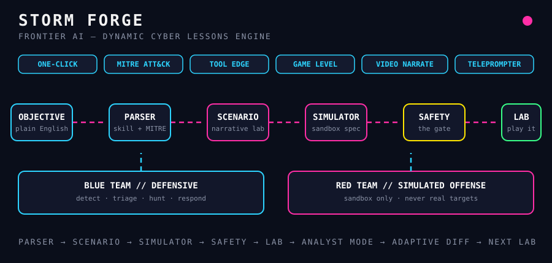
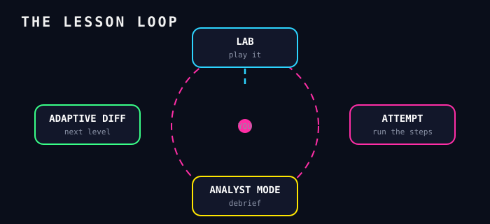

# STORM FORGE

> Frontier models make interesting cybersecurity labs one-shot.
> This engine turns a plain-English objective into a playable lab:
> parsed, scenario-generated, simulator-built, safety-filtered, and
> difficulty-adapted — in one pass.

[](LICENSE)
[](pyproject.toml)
[](#roadmap)

Live concept: the dashboard mockup in
[@Insider747's post](https://x.com/Insider747/status/2117679604684992735) —
one-click labs, MITRE ATT&CK mapping, tool-edge drills, game levels,
video narration, and a lab teleprompter, over blue-team defensive and
red-team simulated-offense tracks.



## How it works

| Step | Stage | What happens |
| ---- | ----- | ------------ |
| 01 | **Pick a module** | One-click, MITRE ATT&CK, Tool Edge, Game Level, Video Narrate, or Lab Teleprompter |
| 02 | **Describe the skill** | Plain English, e.g. "detect LSASS credential dumping" |
| 03 | **Parser** | Objective → skill, MITRE techniques, difficulty, prerequisites |
| 04 | **Scenario Gen** | A narrative lab: story, steps, injects, win conditions |
| 05 | **Simulator Builder** | A sandbox spec: hosts, services, artifacts, telemetry |
| 06 | **Safety Filter + Adaptive Diff** | Blocks real-target/offensive-outbound actions, then tunes difficulty and debriefs via Analyst Mode |



## The engine

```
objective ──► Parser ──► Scenario Gen ──► Simulator Builder ──► Safety Filter ──► Lab
                 │              │                  │                   │
                 └────── MITRE ATT&CK map ─────────┴── telemetry ───────┘
Lab ──► Learner attempts ──► Analyst Mode debrief ──► Adaptive Diff ──► next Lab
```

- **Parser** (`src/storm_forge/engine/parser.py`) — objective to structured intent.
- **Scenario Gen** (`src/storm_forge/engine/scenario_gen.py`) — narrative, steps, injects.
- **Simulator Builder** (`src/storm_forge/engine/simulator_builder.py`) — sandbox spec only. No real infrastructure is touched.
- **Safety Filter** (`src/storm_forge/engine/safety_filter.py`) — the load-bearing gate. Red-team tracks are **simulated offense inside a sandbox**: no real targets, no outbound attacks, no credential use. Anything that fails the filter never builds.
- **Adaptive Diff** (`src/storm_forge/engine/adaptive_diff.py`) — difficulty follows performance.
- **Analyst Mode** (`src/storm_forge/engine/analyst_mode.py`) — debriefs attempts into a readable report.

## Modules

| Module | What it is |
| ------ | ---------- |
| **ONE-CLICK** | Full pipeline in one command |
| **MITRE ATT&CK** | Labs mapped to techniques (e.g. T1003.001 LSASS) |
| **TOOL EDGE** | Tool-first drills: one tool, one technique, timed |
| **GAME LEVEL** | XP, levels, streaks over lab completions |
| **VIDEO NARRATE** | Narration script for a lab walkthrough video |
| **LAB TELEPROMPTER** | Step-by-step on-screen cues while you run the lab |

## Tracks

- **BLUE TEAM // DEFENSIVE** — detect, triage, hunt, respond. Example: spot LSASS access in Sysmon telemetry and write the detection.
- **RED TEAM // SIMULATED OFFENSE** — adversary emulation against the sandbox only. Example: run a simulated credential-dump chain and watch the blue-team telemetry light up. Nothing here ever points at a real system.

## Quickstart

```bash
pip install -e .
python -m storm_forge.cli one-click "detect LSASS credential dumping"
python -m storm_forge.cli narrate "detect LSASS credential dumping"
python -m storm_forge.cli teleprompter "detect LSASS credential dumping"
```

The skeleton runs entirely offline with a built-in demo mapping — no model
calls, no sandbox backend yet. It prints the lab spec as JSON so you can
see the shape of every stage.

## Project layout

```
src/storm_forge/
  cli.py                  # one-click / narrate / teleprompter commands
  engine/
    parser.py             # objective -> intent
    scenario_gen.py       # intent -> narrative lab
    simulator_builder.py  # lab -> sandbox spec
    safety_filter.py      # the gate: sandbox-only, no real targets
    adaptive_diff.py      # difficulty from performance
    analyst_mode.py       # attempts -> debrief
  modules/
    one_click.py  mitre_attack.py  tool_edge.py
    game_level.py  video_narrate.py  lab_teleprompter.py
  teams/
    blue_team.py  red_team.py       # track presets (simulated offense only)
examples/quickstart.py
docs/
  index.html              # landing page with Open Graph + Twitter Card meta
  diagrams/
    architecture.svg      # animated pipeline
    lesson-loop.svg       # animated adaptive loop
```

## Roadmap — the rest is yours

- [ ] Plug a frontier model into `Scenario Gen` (provider interface stubbed in code)
- [ ] Real sandbox backend behind `Simulator Builder` (containers/VMs, telemetry feed)
- [ ] MITRE ATT&CK data import (STIX/TAXII or the ATT&CK JSON release)
- [ ] TTS voice for Video Narrate, overlay UI for Lab Teleprompter
- [ ] Game Level persistence (SQLite) and streaks
- [ ] Analyst Mode grading against telemetry, not just attempt counts

## License

MIT — see [LICENSE](LICENSE). Built in the open; defensive use first.
